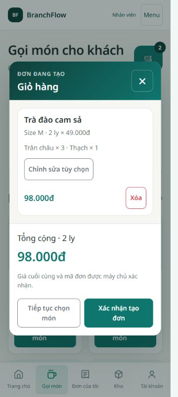

# Hướng dẫn Admin Chi nhánh và Employee

WBS 5.2.3 • Công Thành • 10/11/2026 • Bản local trên nền 47541ee và working tree tuần 5. Thao tác được đối chiếu với các lượt UI trong [UAT](Sprint5-UAT-Responsive.md). Chờ người dùng độc lập làm theo hướng dẫn và PM review. Phần Owner/Admin Tổng do Khang phụ trách chưa có bản hướng dẫn riêng để đối chiếu thống nhất.

## Bắt đầu

Mở trang đăng nhập do quản lý cung cấp. Local Dev: https://localhost:7132/login; môi trường kiểm thử riêng dùng cổng 17132. Nhập tên đăng nhập và mật khẩu được cấp, chọn **Đăng nhập**. Không chia sẻ mật khẩu trong ảnh hoặc tài liệu nhóm. Ví dụ tên demo: `demo.branchadmin.01`, `demo.employee.a`; mật khẩu nhận riêng.

Sau đăng nhập, kiểm tra đúng vai trò và chi nhánh. Trên điện thoại, dùng thanh điều hướng dưới cùng hoặc **Menu** trên đầu trang để mở đầy đủ chức năng. Bảng nhiều cột có thể kéo ngang bên trong bảng.

## Employee: tạo một đơn

1. Mở **Gọi món**, kiểm tra chi nhánh trên đầu trang. Nếu chưa được phân công, liên hệ quản lý; không dùng tài khoản khác để lách quyền.
2. Tìm theo tên hoặc chọn danh mục. Không có kết quả thì chọn **Bỏ lọc** hoặc **Xem toàn bộ menu**.
3. Chọn **Chọn món**. Chọn đúng một size; mỗi loại topping tối đa 3 phần trên mỗi ly. Có thể chọn nhiều loại topping. Ghi chú nhanh mỗi nhóm tối đa một lựa chọn.
4. Điều chỉnh **Số lượng ly**. Số phần topping áp dụng cho từng ly. Ví dụ M 30.000đ, 3 Trân châu 5.000đ và 1 Thạch 4.000đ: mỗi ly 49.000đ; hai ly 98.000đ.
5. Chọn **Thêm vào đơn**, mở nút giỏ hàng. Kiểm tra size, topping, số ly và tổng. Dùng **Chỉnh sửa tùy chọn** hoặc **Xóa** nếu cần.
6. Chọn **Xác nhận tạo đơn** một lần. Chờ máy chủ trả mã và số tiền chính thức. Thành công chuyển sang **Chi tiết đơn**; lưu mã để tra cứu.

Nếu mất kết nối hoặc không rõ đơn đã được tạo chưa, giữ giỏ và kiểm tra **Đơn của tôi** trước khi tạo lại. Khi giao diện khóa gửi vì chưa xác định kết quả, làm theo hướng dẫn kiểm tra lịch sử/đăng nhập lại. Không coi thiếu thông báo thành công là chắc chắn chưa tạo đơn.

## Employee: tra cứu và xem đơn

Mở **Đơn của tôi**, nhập **Mã đơn hàng**, chọn **Ngày kinh doanh** nếu cần rồi bấm **Tìm đơn**. **Bỏ bộ lọc** để xem lại danh sách. Bấm **Xem chi tiết** để xem giá và tùy chọn đã lưu. Employee chỉ xem đơn của mình trong phạm vi còn được phép truy cập.

Trạng thái hiển thị: **Hoàn tất** (COMPLETED), **Cần xem lại** (NEEDS_REVIEW), **Đã hủy** (CANCELLED). Trạng thái Cần xem lại trong dữ liệu mẫu không có nghĩa đã có quy trình báo sai/phê duyệt nhiều bước. Sau Admin điều chỉnh/hủy, tải lại đơn để thấy dữ liệu mới.

## Admin Chi nhánh: menu

Mở **Menu**, chọn chi nhánh được phép nếu quản lý nhiều nơi. Tìm món, dùng **Mở bán** hoặc **Ngừng bán** để thay trạng thái bán tại chi nhánh. Topping chọn trong **Danh mục quản trị**. Admin Chi nhánh không sửa giá, size hoặc xóa món chung. Nếu món bị tắt toàn hệ thống, cần Admin Tổng xử lý; bật tại chi nhánh không vượt được trạng thái chung.

## Admin Chi nhánh: sửa hoặc hủy đơn

1. Mở **Đơn hàng**, lọc chi nhánh và **Từ ngày / Đến ngày**, bấm **Xem kết quả**.
2. Bấm **Xem chi tiết** ngay dưới mã đơn. Chỉnh **Số ly** theo giá, size và topping đã lưu khi tạo đơn.
3. Nhập **Lý do sửa hoặc hủy**, chọn **Lưu số ly** để lưu điều chỉnh.
4. Để hủy, nhập lý do, chọn **Hủy đơn**, kiểm tra mã rồi bấm **Xác nhận hủy đơn …**. **Giữ đơn** để bỏ bước xác nhận.
5. Kiểm tra trạng thái và **Lịch sử chỉnh sửa**, rồi bấm **Về danh sách đơn** để tiếp tục tra cứu với bộ lọc hiện tại.

## Kho cho Admin Chi nhánh và Employee được cấp quyền

Mở **Kho** để xem tồn, ngưỡng cảnh báo và **Lịch sử nhập xuất**. Mở từng phiếu để xem trước/sau và lượng thay đổi. **Tải lại tồn kho và lịch sử** để cập nhật dữ liệu.

Các nút **Nhập kho** và **Xuất kho** xuất hiện theo quyền của tài khoản tại chi nhánh đã chọn. Liên hệ quản lý nếu cần cấp thêm quyền.

1. Kiểm tra chi nhánh rồi bấm **Nhập kho** hoặc **Xuất kho**.
2. Chọn nguyên liệu, xem tồn hiện tại rồi nhập số lượng theo đơn vị hiển thị. Dùng **Thêm nguyên liệu** hoặc **Bỏ dòng** để chỉnh danh sách.
3. Nhập **Lý do**, bấm **Xác nhận nhập kho** hoặc **Xác nhận xuất kho** và chờ mã phiếu.
4. Mở **Xem tồn kho** và **Lịch sử nhập xuất** để đối chiếu số dư và phiếu vừa ghi.

Nếu không rõ kết quả ghi, tải lại và kiểm tra lịch sử trước khi ghi tiếp. Bán hàng không tự trừ nguyên liệu. Bản MVP chưa có kiểm kê hoặc duyệt phiếu. Admin Chi nhánh có thể sửa ngưỡng ở dòng tồn rồi **Lưu ngưỡng**; Employee không quản lý ngưỡng.

## Hồ sơ nhân viên và doanh thu cho Admin Chi nhánh

**Nhân viên**: mở **Sửa hồ sơ** của Employee trong chi nhánh, sửa thông tin được phép rồi **Lưu hồ sơ**. Admin Tổng tạo tài khoản và phân công ban đầu; Admin Chi nhánh không tạo tài khoản, đổi vai trò hoặc điều chuyển nhân viên đang có phân công.

**Tổng quan**: chọn khoảng ngày và chi nhánh, bấm **Xem kết quả**. Ngày tính theo giờ Việt Nam từ thời điểm tạo; doanh thu chỉ gồm đơn đang COMPLETED. Đơn CANCELLED/NEEDS_REVIEW không tính. Tổng có thể bao gồm đơn cũ ngoài bộ demo. Khoảng từ ngày phải không muộn hơn đến ngày.

## Khi gặp lỗi và kết thúc

| Hiện tượng | Cách xử lý |
|---|---|
| Không kết nối được dịch vụ | Kiểm tra Web/API đang chạy, chờ rồi Thử lại; không đổi mật khẩu để chữa lỗi kết nối |
| Sai tài khoản hoặc không khả dụng | Kiểm tra thông tin, trạng thái khóa và liên hệ quản lý |
| Thử quá nhiều lần | Chờ theo thông báo rồi thử lại |
| Không có dữ liệu trong phạm vi | Kiểm tra chi nhánh, phân công, mã và bộ lọc; không suy rằng dữ liệu đã bị xóa |
| Phiên hết hạn | Đăng nhập lại; với POST chưa rõ kết quả, kiểm tra lịch sử trước khi gửi tiếp |
| Dữ liệu kho đã đổi / xung đột | Tải lại tồn, kiểm tra lịch sử và nhập theo dữ liệu mới |

Kết thúc bằng **Đăng xuất**; trên mobile mở Menu nếu nút chưa thấy. Không dùng `/preview/*` làm minh chứng chức năng thật. Bảng lương, điều chuyển, kiểm kê và dashboard nâng cao ngoài phạm vi đợt này.
